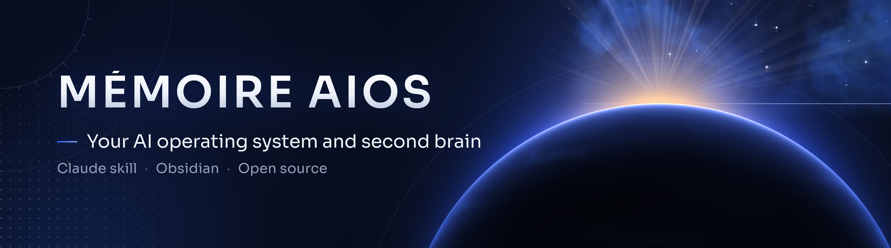
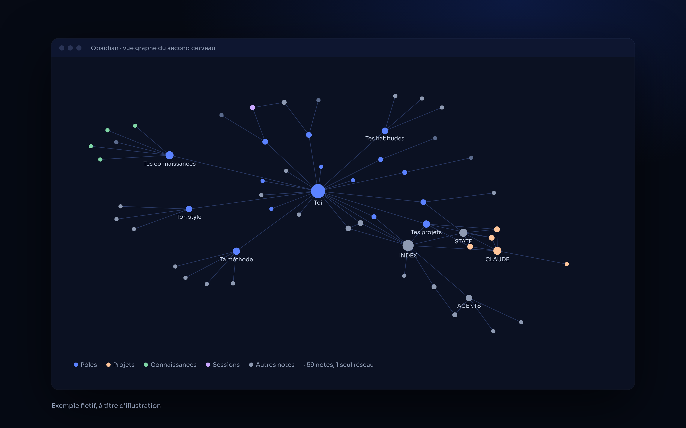
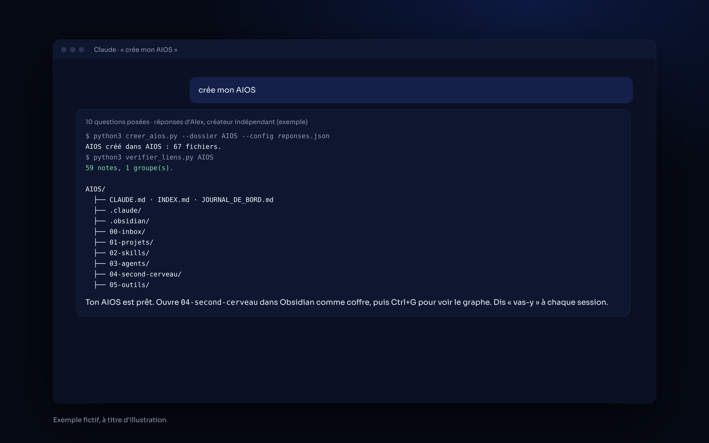

<p align="center">
  
</p>

<p align="center">
  
  
  
</p>

# memoire-aios

**Un skill Claude pour construire ton propre AIOS (un système complet autour de Claude) et le faire vivre avec un second cerveau Obsidian où tout est noté et relié : idées, décisions, erreurs, résumés de vidéos, habitudes, skills, sessions.**
*A Claude skill that builds your own AI operating system around Claude and keeps a linked Obsidian second brain up to date, automatically.*

## ✦ Ce que fait le skill

**Création (une seule fois)**
- 10 questions : qui tu es, tes objectifs, tes projets, ta façon de travailler, ton style, tes règles, tes sujets, tes outils.
- Un script crée tout le dossier : règles (`CLAUDE.md`), tableau de bord (`INDEX.md`), un dossier par projet, skills, agents, outils, et le second cerveau avec ses pôles, ses modèles et la configuration Obsidian (couleurs du graphe).
- Tout est relié : un vérificateur garantit qu'aucune note n'est isolée dans le graphe.

**Mémoire (à chaque session)**
- Au début : Claude lit la mémoire. Dis « vas-y » et il reprend où tu en es.
- Pendant : il note chaque idée, décision, erreur (avec la règle pour ne pas refaire), source, habitude et skill.
- À la fin : note de session, tableau de bord et état du projet mis à jour, même sans « fin de session ».
- Plus tard : il répond « D'après tes notes… » en citant tes sources, et retrouve les notes liées à un sujet avant de répondre (`rappels.py`).

**Entretien (chaque semaine)**
- Contrôle de santé en lecture seule : STATE.md complets et à jour, projets sans STATE ou DECISIONS, sauvegardes à purger, fichiers en vrac (`controle_aios.py`).
- Consolidation, comme le sommeil : sessions anciennes résumées en récap mensuel, doublons et notes trop maigres signalés, rien n'est supprimé (`consolider.py`).

## ✦ Aperçu

Le graphe Obsidian d'un AIOS tout juste créé, puis la création en une phrase (sortie réelle des scripts, avec les réponses d'exemple) :

<p align="center">
  
  
</p>

<p align="center"><sub><i>Exemple fictif, à titre d'illustration.</i></sub></p>

## ✦ Prérequis

- Claude avec accès à un dossier de ton ordinateur (Cowork, Claude Code, ou chat lié à l'ordinateur) et Python 3.
- [Obsidian](https://obsidian.md) (gratuit) pour la vue graphe.

## ✦ Installation

**Télécharger** : bouton vert **Code → Download ZIP**, ou :

```bash
git clone https://github.com/horizonchapter/memoire-aios.git
```

**Claude Code** (pour tous tes projets) :

```bash
cp -r memoire-aios/skills/memoire-aios ~/.claude/skills/
```

**Claude (app et web)** : importe le fichier [`memoire-aios.zip`](memoire-aios.zip) dans les réglages des skills de Claude.

## ✦ Utilisation

1. Dis à Claude : « crée mon AIOS ».
2. Ouvre le dossier créé dans Obsidian (« Ouvrir un dossier comme coffre »), puis Ctrl+G.
3. Ensuite, à chaque session : « vas-y », « note ça », « retiens », « résume cette vidéo ».

## ✦ Structure

```
memoire-aios/
├── skills/memoire-aios/
│   ├── SKILL.md                 le skill
│   ├── scripts/
│   │   ├── creer_aios.py        crée l'AIOS à partir des réponses ; n'écrase jamais un fichier existant
│   │   ├── verifier_liens.py    vérifie que toutes les notes forment un seul réseau dans Obsidian
│   │   ├── rappels.py           retrouve les notes liées à un sujet
│   │   ├── controle_aios.py     contrôle de santé, en lecture seule
│   │   └── consolider.py        consolidation hebdomadaire, sans rien supprimer
│   └── exemples/                arborescence créée, réponses d'exemple, fiche source
├── memoire-aios.zip             le même skill, prêt à importer
└── assets/                      bannière et aperçus
```

Structure créée : voir [`arborescence.md`](skills/memoire-aios/exemples/arborescence.md). Exemple de réponses : [`reponses-exemple.json`](skills/memoire-aios/exemples/reponses-exemple.json).

## ✦ Voir aussi

- [claude-second-brain](https://github.com/horizonchapter/claude-second-brain) : les modèles `CLAUDE.md` / `STATE.md` / `DECISIONS.md`.
- [context-transfer](https://github.com/horizonchapter/context-transfer) : reprendre dans un nouveau chat sans rien perdre.
- [chef-employe](https://github.com/horizonchapter/chef-employe) · [claude-routines](https://github.com/horizonchapter/claude-routines) · [mods-claude-code](https://github.com/horizonchapter/mods-claude-code) · [pdf-luxe](https://github.com/horizonchapter/pdf-luxe)

## ✦ Licence

[MIT](LICENSE). Libre d'utilisation, de modification et de partage.
